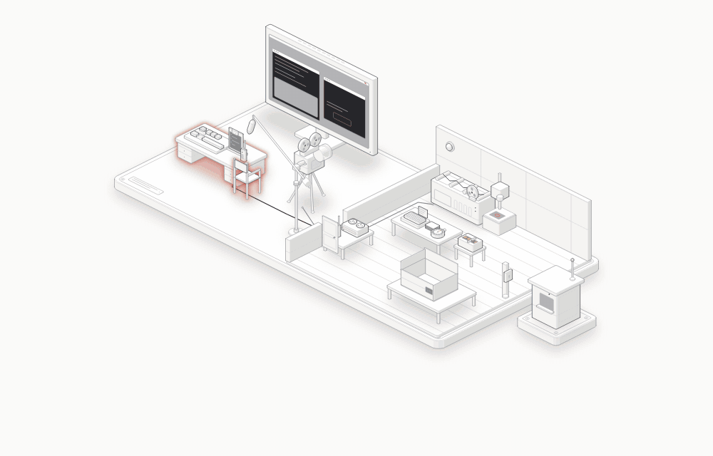
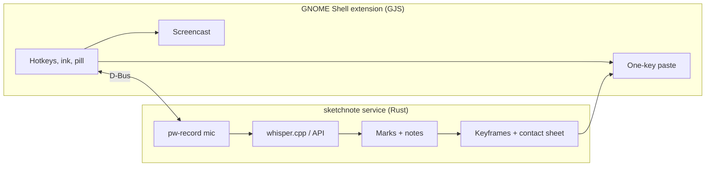

<div align="center">


# Sketchnote

**Show your coding agent the problem.**<br>
Talk, draw on your screen, and paste timestamped notes with annotated frames into any agent with one Ctrl+V.

[Website](https://get.sketchnote.workers.dev) · [Install](#install) · [How it works](#how-it-works)

[](https://github.com/BilalIrfanContact/sketchnote/actions/workflows/ci.yml)
[](https://github.com/BilalIrfanContact/sketchnote/releases/latest)


<picture>
  <source media="(prefers-reduced-motion: reduce)" srcset="docs/images/anatomy-light.png">
  
</picture>

</div>

Describing a UI bug in words is slow and lossy. With Sketchnote you press **Alt+Shift+S**, explain the problem out loud, and circle what you mean while you talk. When you finish, it transcribes your voice, ties each sentence to the mark you drew while saying it, and crops a keyframe around every mark. One Ctrl+V pastes the numbered notes, then a contact sheet of the frames, into Claude Code, Codex, a chat box, or anything else that accepts text and images.

It's a native GNOME Shell extension with a Rust service behind it. Transcription runs locally by default, so nothing leaves your machine unless you paste it.

## Install

Requires **GNOME 50** on Wayland, an x86_64 CPU with AVX2, FMA and F16C (most since about 2015), and `ffmpeg` and `pw-record`.

```sh
curl -fsSL https://get.sketchnote.workers.dev/install | bash
sketchnote setup
```

The installer checks every requirement up front and names anything missing. It places the prebuilt binary in `~/.local/bin` and the extension in `~/.local/share/gnome-shell/extensions/`, with no compiler or Rust toolchain needed. `setup` downloads the speech model (Whisper `small`, 264 MB) and a voice detector, tests your microphone, and lets you choose between local and API transcription. Then **log out and back in once**, since GNOME on Wayland only loads new extensions at login.

`sketchnote update` installs newer releases in place. It keeps your downloaded models, never interrupts a capture in progress, and tells you if the extension changed.

## Use

| Key | Action |
|---|---|
| **Alt+Shift+S** | Start a capture, or finish the running one (the pencil icon in the top bar does the same) |
| **Shift + drag** | Draw. Strokes fade on screen after about 1.5 s but are kept in the output |
| **Shift + click** | Drop a numbered pin |
| Click | Logged as a click, shown as a blue ring in the output |
| **Ctrl+Z** · **Esc** | Undo the last stroke or pin · cancel and discard the capture |
| **Ctrl+V** | Right after a capture is ready: paste its notes and contact sheet together |
| **Alt+Shift+V** | Paste the latest capture again, any time |

A pill at the top of the screen shows the state: **Recording** with a timer and mic level, then **Transcribing…**, then **Ready · Ctrl+V to paste**. If a build fails, a notification explains why in plain words and offers **Retry**; the recordings are kept, so nothing is lost.

<details>
<summary>Pill states in detail</summary>

- **Starting…** (grey dot): GNOME's screen recorder isn't running yet. The mic starts within about 0.1 s.
- **Recording** (red dot): timer, a mic level bar on a fixed −60 to 0 dBFS scale, a red glow around the screen and a stop icon in the top bar. The pill has Undo, Cancel and Finish buttons.
- **Mic is silent** (amber): the mic has recorded only digital silence for 3 seconds, so it's muted, or the wrong or a disconnected input. It clears as soon as sound comes in.
- **Saving…** then **Transcribing…** (amber): about 10 s for 20 s of speech with the local model.
- **Ready · Ctrl+V to paste** (green): the notes are on the clipboard. The pill hides after a few seconds.

Ctrl+V pastes the notes, swaps the clipboard to the contact sheet and pastes again, so both arrive from one key press as ordinary pastes. Once you copy something else, Ctrl+V is normal again.

</details>

## What your agent receives

```
- #1 (0:04) “This footer has too much text, let's cut it down.”
- (0:08) [clicked]
- #2 (0:10) “And the model name here is out of date.”
- #3 (0:11) [clicked] “This button should open the settings instead.”
```

…followed by a contact sheet: the cropped keyframes in note order, each with its number and your marks drawn on it. Every capture is also kept as a folder in `~/.local/share/sketchnote/captures/`, in case the agent needs more.

<details>
<summary>The capture bundle</summary>

| File | Contents |
|---|---|
| `summary.md` | The notes above, pasted by Ctrl+V or Alt+Shift+V |
| `contact-sheet.png` | Cropped keyframes in rows of two, in note order, with number badges |
| `frames/frame-NN.png` | One keyframe per mark, cropped to the activity, annotations burned in |
| `frames-full/frame-NN.png` | The same keyframes uncropped |
| `recording.mp4` | Screen recording, H.264, 30 fps |
| `audio.wav` | Microphone, 16 kHz mono |
| `sketchnote.json` | Timings, strokes, clicks, pins, target window, word timestamps and marks |
| `finish.json` | What the extension sent on Finish, so a failed build can be retried |
| `error.txt` | Only after a failed build: the full error behind the notification |

</details>

## Transcription

By default, speech is transcribed **on your CPU** with whisper.cpp, compiled into the binary, using the `small` model with word-level timestamps. English only, at roughly half real time.

For faster, more accurate notes, you can point Sketchnote at a **transcription API**: Groq, OpenAI, or a self-hosted server, as long as its model returns word timings. Only the microphone recording is sent, never the screen. The API key lives in GNOME Keyring, never in a file. If the API fails for any reason (no network, a rejected key, no credit left, an outage), the local model takes over and a notification says what went wrong, so a capture is never lost.

<details>
<summary>Choosing a local model</summary>

Create `~/.config/sketchnote/config.toml`, then run `sketchnote download-model`. The next capture uses it; nothing needs restarting.

```toml
[local]
model = "large-v3-turbo-q8_0"
```

Names are a size (`tiny`, `base`, `small`, `medium`, `large-v3`, `large-v3-turbo`), optionally `.en` for English-only and `-q5_0`, `-q5_1` or `-q8_0` for a smaller file, as listed on [Hugging Face](https://huggingface.co/ggerganov/whisper.cpp/tree/main). Bigger models hear better but run slower: on a laptop CPU, 30 s of speech took 2 s with `tiny-q8_0` and 26 s with the default `small-q8_0`.

</details>

<details>
<summary>Using an API</summary>

```toml
transcriber = "api"

[api]
url = "https://api.groq.com/openai/v1"
model = "whisper-large-v3-turbo"
```

Then run `sketchnote set-key` and paste the key. Keys are stored per `url`; leave the key empty to remove it. Set `transcriber = "local"`, or remove the line, to go back.

| Provider | `url` | `model` | Price |
|---|---|---|---|
| [Groq](https://console.groq.com) (default) | `https://api.groq.com/openai/v1` | `whisper-large-v3-turbo`, or `whisper-large-v3` for a little more accuracy | about $0.04 per hour of audio |
| OpenAI | `https://api.openai.com/v1` | `whisper-1` (retired on 2027-02-26; newer OpenAI models give no word timings) | $0.36 per hour |
| [Speaches](https://github.com/speaches-ai/speaches), self-hosted | e.g. `http://localhost:8000/v1` | e.g. `Systran/faster-whisper-large-v3` | free |

When the API falls back to the local model, the pill says "Ready (local model)", and the notification's Retry transcribes through the API again once you've fixed the cause.

</details>

## Privacy

- A capture records your **whole screen** (every monitor) and your **microphone**, from Alt+Shift+S until you finish or cancel.
- Everything stays local by default. Only what you paste leaves, and only to where you paste it. With an API, the microphone recording goes to that provider under its own data policy.
- Captures delete themselves once they've sat unchanged for **24 hours**; the service checks at startup and hourly. Cancelling deletes a capture immediately. The retention period is `KEEP_CAPTURES` in `src/service.rs`.

## How it works



Sketchnote has two halves that talk over D-Bus (`org.sketchnote.Service`). The **extension** lives inside GNOME Shell. It owns the hotkeys, live ink, pins, click logging and the paste, and it records the screen through the Shell's own Screencast service. Only the Shell may call that service, which is why there's no screen-sharing prompt and why this part has to be an extension. The **service** is a Rust binary that D-Bus starts on demand. It records the microphone, transcribes, and builds the bundle.

A few problems that were more interesting than they look:

- **Matching speech to marks.** Each sentence goes to the mark it overlaps most in time. A sentence is only split where you paused for at least a second, so "this part… this part… and this part" lands on three different circles, while a thought that spans two marks stays whole.
- **Honest word timings from APIs.** API transcribers stretch each word across the silence around it, which hides those pauses. Sketchnote re-times the API's words against the speech that a local voice-activity model finds in the recording.
- **Text and an image from one key.** A clipboard reliably holds one thing at a time. So the extension takes over Ctrl+V for a single paste: it pastes the notes, swaps the clipboard to the image and pastes again through a virtual keyboard, then restores normal behaviour.
- **A portable binary.** Releases are built on Ubuntu 24.04 with whisper.cpp pinned to an AVX2/FMA/F16C baseline instead of the build machine's CPU, so one binary runs on any GNOME 50 machine from the last decade. The cost is about 20% of transcription speed.
- **Safe self-update.** `update` stages the new binary and extension beside the old ones and swaps them in only when everything is in place. It asks the running service to quit once it's idle, so an update never interrupts a recording or a transcription.

| Path | Role |
|---|---|
| `extension/sketchnote@local/extension.js` | Hotkeys, ink, pill, pins, clicks, screen recording, paste |
| `src/service.rs` | D-Bus service: mic recording, capture lifecycle, retention |
| `src/notes.rs` | Events into marks, speech assigned to marks, `summary.md` |
| `src/transcribe.rs` · `src/api.rs` | whisper.cpp with DTW word timestamps and voice-activity re-timing · the API client |
| `src/bundle.rs` · `src/media.rs` · `src/draw.rs` | Bundle assembly, ffmpeg video and frames, keyframes, crops, contact sheet |
| `src/setup.rs` · `src/update.rs` | First-run setup · self-update |
| `site/` | The landing page, hosted on Cloudflare (`npx wrangler deploy`) |

<details>
<summary>Design decisions</summary>

These are the simplest options, picked deliberately.

- **Hotkeys** are constants at the top of `extension.js`. There's no settings UI.
- **Whole screen only.** A capture records all monitors as one image, so you can switch apps freely. There's no area or window mode; the contact sheet already crops each keyframe around your marks.
- **Marks.** Every stroke and pin is a numbered mark. A click is numbered only if something you said lands on it; otherwise it's an unnumbered `[clicked]` line with no keyframe, unless the capture has only clicks and none were spoken about. Words before the first mark go to #1. Without punctuation, words are split at marks by time. With no marks at all, the whole capture becomes one note on the last frame.
- **Tags.** Clicks are tagged `[clicked]` and pins `[pin]`. `summary.md` has no header, because the image is pasted alongside it; the target app and window are in `sketchnote.json`.
- **Pins** are red dots that fade like strokes. They show no number while recording, because numbers are only final once the notes are built.
- **Undo** removes the last stroke or pin. Clicks can't be undone, and clicks on the pill or top bar aren't logged.
- **Timing.** Strokes stay 0.5 s, then fade over 1 s. Keyframes are taken 0.1 s after a mark lands. Each crop is the activity's bounding box plus 160 px, at least 640×400, clamped to the window underneath.
- **Paste.** The two pastes are 0.4 s apart. Alt+Shift+V waits until Alt and Shift are released, otherwise the app would see Ctrl+Alt+Shift+V.
- **Esc and Ctrl+Z** are grabbed globally, but only while a capture runs.

</details>

<details>
<summary>Known limitations</summary>

- **Shift is reserved while capturing.** While it's held, clicks, drags and keys go to Sketchnote, so you can't Shift+click to select or type capital letters mid-capture. Shift was chosen over Space because laptops switch the touchpad off while a non-modifier key is held.
- **The recording includes Sketchnote's own UI.** GNOME's screencast can't exclude Shell actors, so `recording.mp4` shows the pill, the glow and the live strokes. Keyframe crops avoid the pill and the glow where they can, and strokes are redrawn crisply on top.
- **Recording start lag.** GNOME's screencast takes about 0.5 to 2 s to start, and once took 14 s, so the first moment may be missing from the video. Both start offsets are recorded and applied. A new capture started right after the last one waits for the previous recording to stop.
- **The pill sits on the primary monitor.**
- **Clicks are polled every 10 ms**, so a press shorter than that could be missed.
- **English only.** Auto-detection was slower and sometimes picked the wrong language.
- **Heavy work runs niced.** Building runs at nice 10, and transcription uses half the cores, so the desktop stays responsive.

</details>

## Development

```sh
./build-from-source.sh      # cargo build, models, extension symlink, D-Bus file (needs Rust and cmake)
cargo test                  # notes, speech assignment, crops, layout
tests/e2e.py speech.wav     # the full workflow in a throwaway headless GNOME Shell
```

`e2e.py` never touches your session. It starts `gnome-shell --headless` on a private bus with its own dconf, plays any WAV of speech into a virtual microphone, and drives real keyboard and pointer input through Mutter's RemoteDesktop API: strokes, clicks, pins, undo, cancel-and-restart, finishing, and both paste paths. It then checks the bundles and the pasted output.

CI runs `cargo fmt --check`, clippy with warnings as errors, and `cargo test` on every pull request, and syntax-checks the extension and scripts. Pushing a `v*` tag builds and publishes a release. `sketchnote transcribe file.wav` prints a recording's words with timestamps, which is useful when tuning transcription.

## Uninstall

```sh
gnome-extensions disable sketchnote@local
rm -r ~/.local/bin/sketchnote ~/.local/share/gnome-shell/extensions/sketchnote@local \
      ~/.local/share/dbus-1/services/org.sketchnote.Service.service
```

Add `~/.local/share/sketchnote` to also remove the models and any remaining captures.
