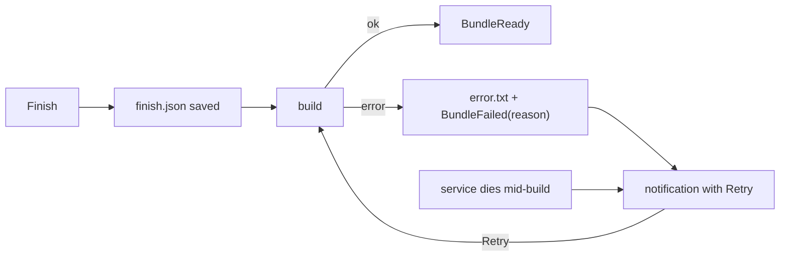

# Errors that say what to do, with Retry

**Date:** 2026-10-21 · **Source:** [`src/fix.rs`](../../src/fix.rs), [`src/service.rs`](../../src/service.rs), [`src/bundle.rs`](../../src/bundle.rs), [`extension.js`](../../extension/sketchnote@local/extension.js)

## What I found

When building a capture's notes failed, the pill said "Couldn't build the notes" and a notification said `Could not build ~/.local/share/sketchnote/captures/<timestamp>.bundle; see the journal`. The service is started by D-Bus activation, so its stderr lands in the shared `dbus.service` journal, which nobody would think to look in. Failures to start a recording showed the raw D-Bus error, such as `GDBus.Error:org.freedesktop.DBus.Error.ServiceUnknown: …`.

Worse, a failed build couldn't be redone. The audio and video were still on disk, but the capture data the extension sent on Finish lived only in the service's memory, and converting the video deletes GNOME's raw recording. Two minutes of talking were effectively lost to a missing model or a missing ffmpeg. If the service crashed mid-build (say, whisper.cpp aborting), no signal came at all and the pill stayed on "Transcribing…" forever.

This was item 7 in GPT-6-Astra's product review.

## Decision

- Code that hits a cause the user can fix attaches a `Fix`: one sentence saying what's wrong and what to do. The known causes are a missing speech model, missing ffmpeg or `pw-record`, a full disk, and a missing screen recording. `BundleFailed` now carries that sentence. Anything else says the details are in the bundle's `error.txt`, which always holds the full error.
- On Finish, the service saves what the extension sent as `finish.json`, and a build reads its inputs from there. A new `Retry(dir)` call queues the same build again. It also works after the service restarts, since nothing lives only in memory. The build reuses `recording.mp4` if the raw recording was already converted.
- The extension shows failures as notifications that stay in the message tray, and a failed build's notification has a Retry button. The service's own `notify-send` is gone, so there's one notification, not two. The extension also watches the service's bus name: if it disappears mid-build, that counts as a failure with Retry.

Alternatives considered:

- **Keep failed builds in the service's memory for Retry.** It's less code, but the most common fix (running install.sh) restarts the service and would lose them.
- **Classify any error by its text.** That's brittle. The few causes worth explaining are tagged where they happen instead.
- **A Retry button on the pill.** The failure pill hides after 6 s. The notification stays in the tray until it's dismissed.

## Evidence

On a private D-Bus session with a throwaway data dir, I built a fake capture (3 s test video, silent audio, one pin):

- With no models: `BundleFailed(…, 'The speech model is missing from …/models. Run install.sh to download it, then retry.')`, and `error.txt` had the same sentence. The raw video was already converted and deleted.
- I restarted the service, linked the models in and called `Retry`: `BundleReady`, a complete bundle reusing `recording.mp4`, and `error.txt` removed. `Retry` on a path outside the captures folder was refused.
- With ffmpeg off `PATH`: `"ffmpeg isn't installed. Install ffmpeg with your package manager, then retry."`
- `cargo test`: 18 tests pass, including that a `Fix` is found under outer context. `tests/e2e.py` passes, so the normal Finish → Ready → paste path is unchanged.

The extension's notification and Retry button haven't been tried in a real session yet. Not measured.

## Tradeoffs and limitations

- If the service dies, only the capture the pill is following is marked as failed. Other queued builds are lost silently, though their `finish.json` would let them be retried.
- `pw-record` starting but exiting at once (no mic at all) isn't explained yet. The silent-mic warning covers the commonest version of that.
- An unexplained failure still sends the user to `error.txt`, which is better than the journal but isn't a next step.
