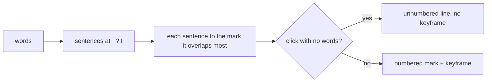

# Keeping sentences whole in the notes

**Date:** 2026-10-21 · **Source:** [`src/notes.rs`](../../src/notes.rs)

## What I found

Each mark got the words spoken from its own start until the next mark, cut purely by time. I talk while I draw, so a click or stroke usually lands mid-sentence and the sentence gets split across two notes:

```
- #1 (0:04) “This button is misaligned, it should line up”
- #2 (0:07) [clicked] “with the text box. Then”
- #3 (0:09) “the header font is too big.”
```

Clicks I made just to move between apps became numbered notes with one word or nothing in them, each with its own keyframe. GPT-6-Astra's product review flagged this as "the notes describe input events, not what you meant".

## Decision

whisper.cpp now punctuates (see [the Rust service entry](2026-10-21-rust-service.md)), so sentence ends are a signal I can trust. Speech is split into sentences at `.`, `?` and `!`, and each whole sentence goes to the mark whose span (from it until the next mark) it overlaps most. Strokes and pins are always numbered. A click is numbered only if a sentence lands on it. Otherwise it stays in the notes as an unnumbered `- (0:07) [clicked]` line, with no keyframe.



Alternatives considered:

- **Split at pauses.** I measured the gaps on two older unpunctuated captures. One had a single pause (1.9 s) in 20 s of speech, so pauses aren't a reliable boundary.
- **Drop silent clicks entirely.** I chose to keep them as unnumbered lines, so the agent still sees the sequence of clicks.

## What changed

The same example now reads:

```
- #1 (0:04) “This button is misaligned, it should line up with the text box.”
- (0:07) [clicked]
- #2 (0:09) “Then the header font is too big.”
```

Words with no sentence end after them fall back to the old time split. That covers older transcripts without punctuation and an unfinished sentence at the end of a capture.

## Evidence

- Replaying the e2e speech capture's saved words and events through both versions: before, 5 of 6 notes started or ended mid-sentence. After, 0 of 6.
- Replaying two of my older unpunctuated captures: the notes match the old time split, except that one click nobody spoke about lost its number.
- `cargo test`: 9 tests pass, including the example above, the unpunctuated fallback, and a clicks-only capture (every click stays numbered).
- `tests/e2e.py` passes.

## Tradeoffs and limitations

- A long sentence spanning several marks goes wholly to one of them, and the others can end up with no text.
- Sentence ends depend on whisper's punctuation. Unpunctuated speech gets the old behaviour.
- Abbreviations like "e.g." count as sentence ends.
- Not measured in my real session yet.
